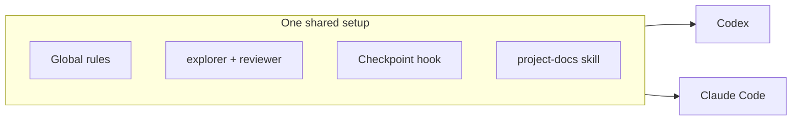
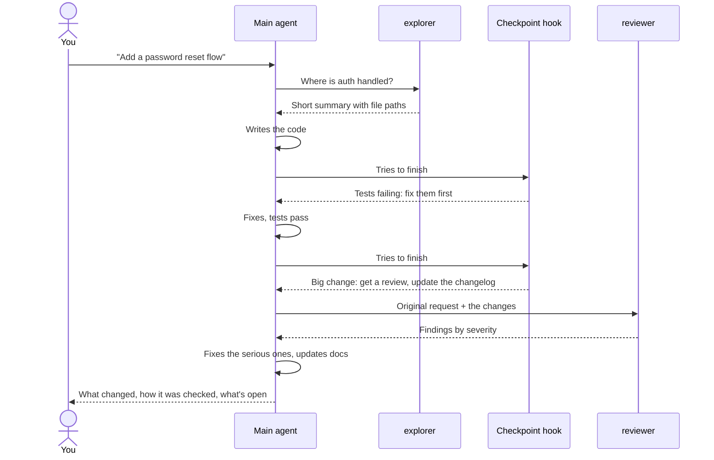

# agent-setup

**My setup for AI coding agents: one set of rules, helpers and quality checks, shared by
Codex and Claude Code, in every project.**

## At a glance



- **Global rules:** one file, read by both tools. Nothing to keep in sync.
- **`explorer`:** a cheap, read-only helper that searches the code.
- **`reviewer`:** a read-only helper with fresh eyes that reviews finished work.
- **Checkpoint hook:** stops the agent from finishing while checks fail, a big change is
  unreviewed, or the changelog is stale.
- **`project-docs`:** gives every project the same docs, so any agent knows where to look.

## How a task runs



The main agent writes all the code; helpers only read. The reviewer never sees the main
agent's plan, so it judges the work with fresh eyes. The hook sends the agent back at most
once per turn and never blocks a session.

## Every project looks the same

```
any-project/
├── AGENTS.md          the map: what it is, commands, where to look, rules
├── CLAUDE.md          one line (@AGENTS.md) so Claude Code reads the same map
├── scripts/verify.sh  fast checks the hook runs
└── docs/
    ├── STATUS.md      where things stand (read first)
    ├── PRODUCT.md     who it's for, scope, non-goals
    ├── DESIGN.md      look, feel, copy
    ├── ARCHITECTURE.md
    ├── DECISIONS.md   what was chosen and why
    └── CHANGELOG.md
```

**Rules become checks.** `scripts/verify.sh` runs each project's lint, type and test tools,
plus one-line project rules. When the same mistake happens twice, it becomes a new check with
an error message that explains the fix, so the agent can't repeat it.

## My skills

52 skills, 46 of them in both tools. Full list: [`docs/SKILLS.md`](docs/SKILLS.md).

| Area | Count | Examples |
|---|:-:|---|
| Mobile apps (Expo) | 18 | `expo-deployment`, `expo-ui`, `greenlight` |
| Video (HyperFrames) | 17 | `hyperframes`, `motion-graphics`, `product-launch-video` |
| Web and visual design | 9 | `taste-skill`, `redesign-skill`, `brandkit` |
| Memory and data | 4 | `memoir`, `treg`, `higgsfield-api` |
| Product and workflow | 4 | `first-customer-finder`, `dont-reinvent`, `project-docs` |

## Install

```bash
git clone https://github.com/Emanuelel/agent-setup.git ~/.agents/agent-setup
python3 ~/.agents/agent-setup/install.py
```

Restart both apps, then approve the hook in Codex under **Settings > Hooks**.
The installer keeps your existing settings, backs up every file it changes, and can be
undone with `python3 install.py --uninstall`.

<details>
<summary>Where everything goes</summary>

```
~/
├── .agents/
│   ├── agent-setup/        this repo
│   ├── hooks/agent_gate.py the checkpoint hook (both tools)
│   └── skills/             shared skills, incl. project-docs
├── .codex/
│   ├── AGENTS.md           THE global rules
│   ├── agents/             explorer.toml, reviewer.toml
│   └── hooks.json
└── .claude/
    ├── CLAUDE.md           one line: @~/.codex/AGENTS.md
    ├── agents/             explorer.md, reviewer.md
    ├── settings.json       hook registered here
    └── skills/project-docs/
```

To change the rules, edit `~/.codex/AGENTS.md`. For agents, templates or the hook, edit this
folder and re-run the installer. Refresh the skills list with `python3 tools/inventory.py`.

</details>

MIT license.
