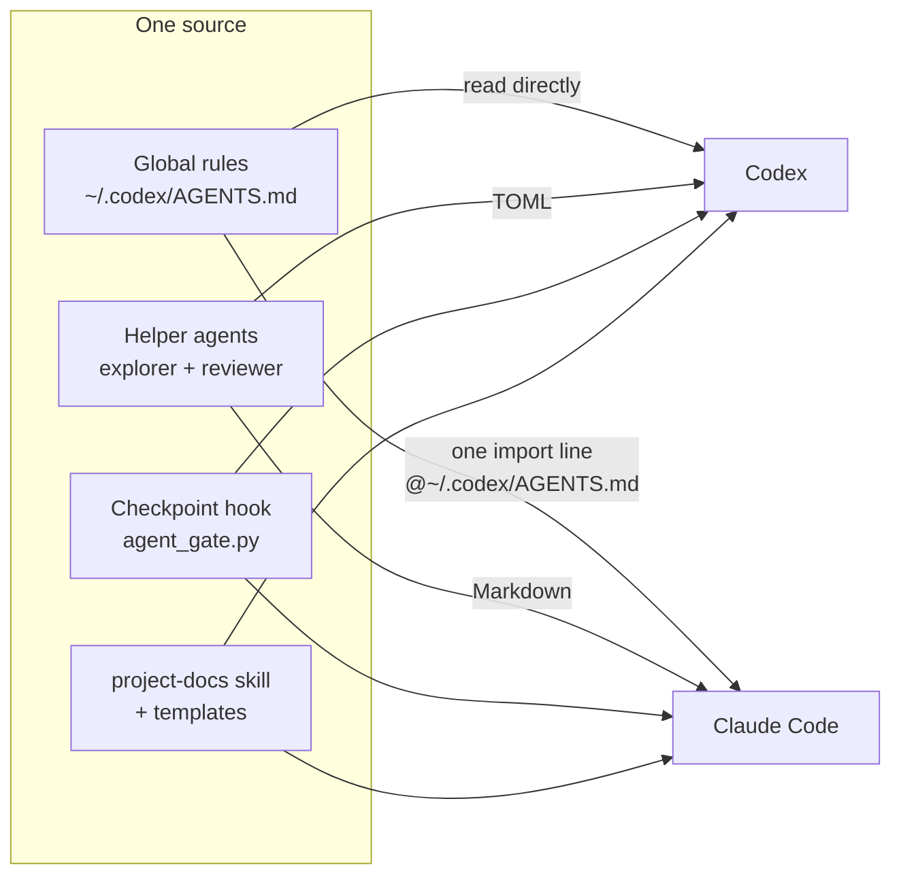
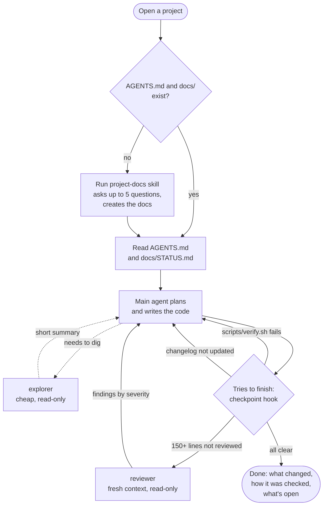
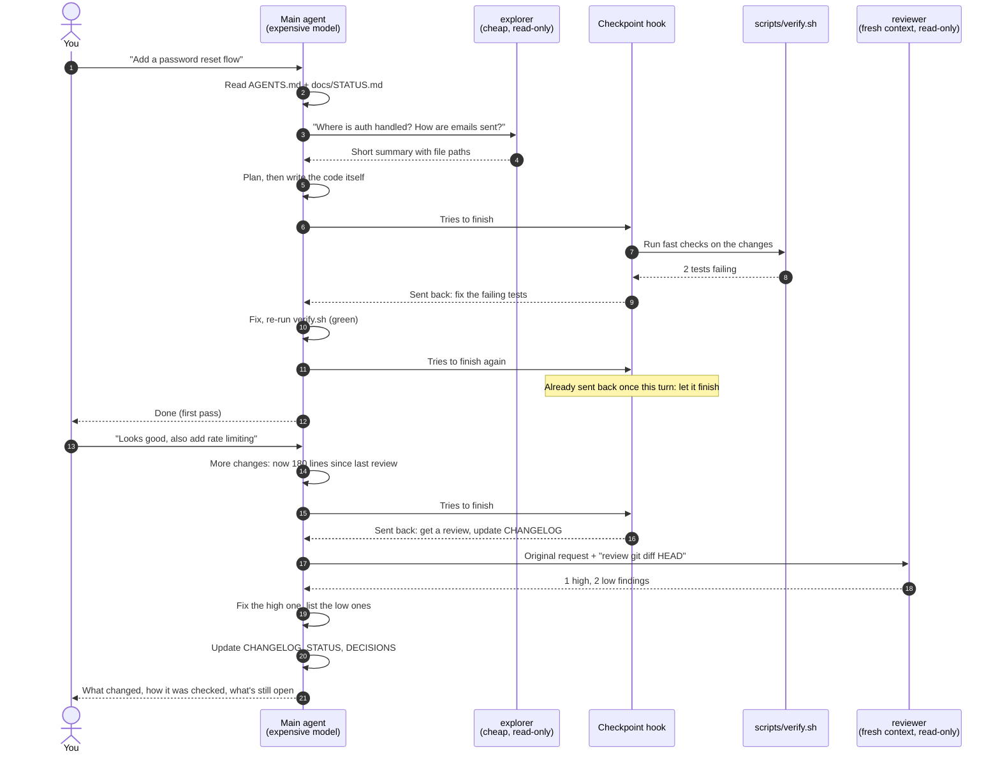

# agent-setup

**One set of rules, helpers and checkpoints for my AI coding agents, shared by Codex and Claude Code.**

I build products with AI coding agents (OpenAI Codex and Anthropic's Claude Code). Out of the box,
each tool needs its own instructions, and every new project starts from zero. This repo fixes
that: one install gives both tools the same global rules, the same helper agents, the same
automatic quality checkpoint and the same project documentation structure, in every project.

The design follows what the tool makers and practitioners recommend as of late 2026:
short instruction files, subagents for reading rather than writing, a fresh-context reviewer
instead of self-review, and "done" defined by checks that actually ran.

---

## The setup at a glance



| Piece | What it does |
|---|---|
| **Global rules** | How every agent works in every project. One real file; Claude Code imports it, so there is nothing to keep in sync. |
| **`explorer` agent** | Cheap, read-only. Searches the codebase and reports back a short summary. |
| **`reviewer` agent** | Strong, read-only, fresh eyes. Reviews finished changes against the original request. |
| **Checkpoint hook** | Runs when the agent tries to finish and can send it back once: to fix failing checks, get a review, or update the changelog. |
| **`project-docs` skill** | Gives every project the same documentation structure, so any agent knows where to look. |

---

## What happens during a task



The hook sends the agent back **at most once per turn**, never loops, and lets the agent finish
whenever anything is unclear (for example, the folder isn't a git project).

---

## How the agents and the hook work together

A typical feature, start to finish:



### What the checkpoint hook checks

Every time an agent tries to finish a turn, `agent_gate.py` looks at the uncommitted changes:

| # | Check | Sends the agent back when... |
|:-:|---|---|
| 1 | **Fast checks** | the project has `scripts/verify.sh` and it fails on the current changes (the last 60 lines of output go back to the agent) |
| 2 | **Independent review** | about 150+ lines of code changed since the last review |
| 3 | **Docs upkeep** | 20+ lines of code changed and `docs/CHANGELOG.md` wasn't touched |

Safety rails: one send-back per turn at most, a turn that only answered a question passes,
any error or timeout lets the agent finish, and its small state file lives inside `.git`, so it
never adds files to your project.

### Who does what

| | Main agent | `explorer` | `reviewer` |
|---|---|---|---|
| **Model** | your main model | Codex `gpt-6-luna` / Claude Haiku | your main model, high effort |
| **Can edit files** | yes | no | no |
| **Sees the plan** | yes | only its question | no: just the request and the diff |
| **Used for** | planning, writing code, final answer | searching code, tracing, reading logs | reviewing finished changes |

---

## Why it's built this way

| Choice | Reason |
|---|---|
| **Main agent writes all code; subagents only read** | Several agents editing code at once tend to make conflicting decisions. Read-only helpers are safe and save the main agent's context. |
| **Reviewer gets only the request and the diff** | A model reviewing its own work in the same context rarely catches a misunderstood request. A fresh reviewer does. |
| **Max 2 review rounds, only critical/high must be fixed** | AI reviewers also over-flag correct code; extra rounds rarely find anything new. |
| **"Done" means `scripts/verify.sh` passed** | Agents sometimes report "tests pass" without running them. A hook is enforcement; an instruction is a suggestion. |
| **Short global rules (~50 lines)** | Instruction files are read every session. Long ones cost more and get followed less. |
| **Docs explain intent, not code** | Agents can read the code. What they can't guess is why, for whom, and what was decided. |

---

## Every project gets the same structure

The `project-docs` skill creates this in any project that doesn't have it yet:

```
any-project/
├── AGENTS.md              the map: what it is, commands, where to look, project rules
├── CLAUDE.md              one line, @AGENTS.md, so Claude Code reads the same map
├── README.md              for humans: what it is, how to run it
├── scripts/
│   └── verify.sh          fast checks (lint, types, tests); the hook runs it
└── docs/
    ├── STATUS.md          where things stand: read this first
    ├── PRODUCT.md         who it's for, the problem, scope, non-goals
    ├── DESIGN.md          look, feel, UI and copy rules
    ├── ARCHITECTURE.md    stack, main parts, data flow, external services
    ├── DECISIONS.md       what was chosen, why, and what was rejected
    └── CHANGELOG.md       what changed, newest first
```

Any agent, or a person, can open the project, read `AGENTS.md` and `docs/STATUS.md`, and know
where everything is. The global rules keep `CHANGELOG`, `STATUS` and `DECISIONS` current after
every task that changes code.

---

## My skills and plugins

Skills are add-on instructions an agent loads only when a task needs them. I keep them in
`~/.agents/skills/`, and most are installed for both tools: **52 skills, 46 of them in both
Codex and Claude Code**. The full, generated list with one-line descriptions is in
[`docs/SKILLS.md`](docs/SKILLS.md).

| Area | Skills | Examples |
|---|:-:|---|
| Mobile apps (Expo / React Native) | 18 | `expo-deployment`, `expo-ui`, `building-native-ui`, `greenlight` (App Store pre-check) |
| Video (HyperFrames) | 17 | `hyperframes`, `motion-graphics`, `product-launch-video`, `pr-to-video` |
| Web and visual design | 9 | `taste-skill`, `redesign-skill`, `image-to-code-skill`, `brandkit` |
| Memory, data and generation | 4 | `memoir` (my local work memory), `treg` (live data and models), `higgsfield-api` |
| Product and startup | 2 | `first-customer-finder`, `dont-reinvent` (build vs buy) |
| How agents work | 2 | `project-docs` (from this repo), `output-skill` |

```
~/.agents/skills/                 shared skill folder (Codex reads it; Claude Code has the same set)
├── project-docs/                 from this repo
├── expo-*, eas-*, ...            mobile
├── hyperframes-*, ...            video
├── taste-skill, redesign-skill   design
└── memoir, treg, ...             memory and data
```

**Plugins:** 13 in Codex (browser, computer use, documents, PDF, slides, spreadsheets, code
review and more), and `claude-seo` in both tools.

To refresh the list after adding or removing skills:

```bash
python3 ~/.agents/agent-setup/tools/inventory.py
```

---

## Install

Requirements: macOS or Linux, Python 3.8+, Codex and/or Claude Code.

```bash
git clone https://github.com/Emanuelel/agent-setup.git ~/.agents/agent-setup
python3 ~/.agents/agent-setup/install.py
```

Then restart Codex and Claude Code, and in Codex approve the hook under **Settings > Hooks**.

The installer:
- keeps anything you already have in those settings files, and saves a backup of every file it
  changes in `~/.agents/backups/`;
- can be run again any time (it only changes what's different);
- removes everything it added with `python3 install.py --uninstall`.

### Where things go

```
~/
├── .agents/
│   ├── agent-setup/            this repo (edit here, then re-run install.py)
│   ├── hooks/
│   │   └── agent_gate.py       the checkpoint hook, shared by both tools
│   ├── skills/
│   │   └── project-docs/       skill for Codex (next to your other skills)
│   └── backups/                a copy of every file the installer changed
├── .codex/
│   ├── AGENTS.md               THE global rules (single source)
│   ├── agents/
│   │   ├── explorer.toml
│   │   └── reviewer.toml
│   └── hooks.json              registers agent_gate.py on "Stop"
└── .claude/
    ├── CLAUDE.md               one line: @~/.codex/AGENTS.md
    ├── agents/
    │   ├── explorer.md
    │   └── reviewer.md
    ├── settings.json           registers agent_gate.py on "Stop" (your other settings kept)
    └── skills/
        └── project-docs/       skill for Claude Code
```

The hook script lives once, at `~/.agents/hooks/agent_gate.py`, and both tools call it.

---

## Make it yours

- **Global rules:** edit `~/.codex/AGENTS.md` directly. Both tools see the change in their next
  session. `rules/starter-rules.md` is only used to create that file on a new computer; adapt it
  before installing (for example, the "talking to the user" section is written for a
  non-developer).
- **Helper agents:** edit `agents/explorer.md` or `agents/reviewer.md`, then re-run the installer.
  `explorer` runs on `gpt-6-luna` in Codex and Haiku in Claude Code; `reviewer` uses your main
  model. Codex model names are the ones in Codex's model picker.
- **Doc templates:** `skills/project-docs/templates/`.
- **Hook thresholds:** environment variables read by `hooks/agent_gate.py`
  (`AGENT_GATE_REVIEW_LINES`, default 150; `AGENT_GATE_CHANGELOG_LINES`, default 20;
  `AGENT_GATE_VERIFY_TIMEOUT`, default 180 seconds).

## Known limits

- The hook only acts in git projects with at least one commit.
- Codex asks you to trust new or changed hooks; Claude Code doesn't.
- In Cowork sessions in the Claude desktop app, imports from outside the session's folder are
  skipped, so the global rules don't load there. Claude Code in the terminal or the Code tab
  loads them normally.

## Repo layout

```
install.py                     installs / updates / removes everything
rules/starter-rules.md         seed for ~/.codex/AGENTS.md on a new computer
agents/explorer.md             one definition, written out for both tools
agents/reviewer.md
hooks/agent_gate.py            the checkpoint hook (shared)
skills/project-docs/           the skill and its templates
tools/inventory.py             writes docs/SKILLS.md from what's installed on this machine
docs/SKILLS.md                 my installed skills and plugins (generated)
```

## License

MIT. Use it, fork it, adapt it.
